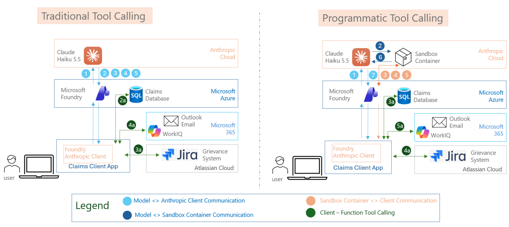

# Cutting token use in agentic apps: Claude on Microsoft Foundry

A Streamlit demo that answers the same question twice, with the same four tools, using two tool-calling strategies side by side, and shows exactly where the tokens go:

1. **Traditional tool calling**: the model decides after every tool result what to do next.
2. **Programmatic tool calling**: the model writes one script that runs in a sandbox and calls the tools itself.

**Prompt caching** is switched on for both, so you can also see how much of the repeated input is served from cache.

---

## Availability on Microsoft Foundry: read this first

Claude models in Foundry can be deployed in two hosting options: **Hosted on Azure** and **Hosted on Anthropic**. At the time of writing, only the Anthropic-hosted option supports programmatic tool calling. The Haiku model used here (`claude-haiku-5-5`) is from the latter: the deployment is created in Foundry, but the model is hosted by Anthropic. Azure-hosted deployments reject the feature with `400 code_execution not supported`.

---

## 1. The scenario

**Srikantan**, a health-insurance patient, opens the app and is greeted: *"Hey Srikantan, how can I help you today with your Insurance Claims?"* The question is fixed: **"Can you get me the status of my claims?"**

To answer it the agent uses four tools:

| # | Tool | What it does | Backend and authentication |
| --- | --- | --- | --- |
| 1 | `get_patient_grievance_mappings` | Returns the Jira grievance ids the patient raised and the claim each one relates to | Local file [`data/patient_grievances.json`](data/patient_grievances.json): **hard-coded dummy data** (patient name → grievance ids → claim ids) |
| 2 | `get_patient_claims` | Returns all of the patient's claims | **Azure SQL** (`dbo.Health_Insurance_Claims`) using **Microsoft Entra ID**: the token from your `az login` session, no password |
| 3 | `get_jira_grievance_status` | Status, assignee, key, summary and created date of one grievance | **Jira Cloud REST API**, authenticated with an **Atlassian API token** |
| 4 | `escalate_unassigned_grievance` | E-mails a person to intervene | **WorkIQ CLI**: runs as *your signed-in Microsoft 365 identity* and sends the mail through `workiq do-action /me/sendMail` |

**Business rule.** For every claim that is **Denied** and has a grievance that is still **unassigned**, send one escalation e-mail (grievance key, summary, created date, patient, claim id) to the address in `ESCALATION_EMAIL`. Never escalate a grievance that already has an assignee.

**The answer.** A status for each claim. For denied claims, it says whether a person is already assigned to the grievance (and who), or that it was escalated because nobody was.

The model itself is reached with your Entra identity too (`DefaultAzureCredential`, scope `https://ai.azure.com/.default`). The only secret in the app is the Jira token in `.env`. **All tools run locally in the client app**; neither the model nor the sandbox ever touches Jira, SQL or Outlook.



*Left: traditional tool calling, where every tool result goes back through the model (flows 1–5, with the client calling the tools in 2a–4a). Right: programmatic tool calling, where the model hands a script to the sandbox container (2), the sandbox asks the client to run the tools (3–5, with the client calling the tools in 3a–5a), and the model returns only for the final answer (6–7). The colour legend is in the diagram.*

The same architecture in text form:

```
┌──────────────────────────────────────────────┐
│ Browser — Streamlit UI                       │    "Can you get me the status of my claims?"
└───────────────────────┬──────────────────────┘
                        │ Streamlit session
┌───────────────────────▼──────────────────────┐
│ app.py                                       │    starts both runs in parallel
│  UI · settings · run history                 │
└───────────────────────┬──────────────────────┘
                        │ run_traditional() · run_programmatic()
┌───────────────────────▼──────────────────────┐            ┌──────────────────────────────────┐
│ core/agents.py                               │  HTTPS +   │ Claude on Microsoft Foundry      │
│  the two approaches                          │◄──────────►│  Messages API · claude-haiku-5-5 │
│  prompt caching · token accounting           │ Entra token│  + code-execution sandbox        │
└───────────────────────┬──────────────────────┘            └──────────────────────────────────┘
                        │ tool_use  →  run locally  →  tool_result
┌───────────────────────▼──────────────────────┐
│ core/tools.py · core/backends.py             │
│  4 tool schemas · dispatch                   │
│  every backend call runs locally here        │
└─────┬───────────┬───────────┬───────────┬────┘
      │           │           │           │
   JSON file   Azure SQL   Jira Cloud  WorkIQ CLI
   (dummy)     (Entra ID)  (API token) (your M365 login)
                                       → Outlook sendMail as you
```

---

## 2. What this demo does to reduce token consumption

| Lever | What it changes | Where to see it |
| --- | --- | --- |
| **Programmatic tool calling** | Intermediate tool results never enter the model's context, and the model is sampled fewer times | Token tables of the two panels; token-mix chart |
| **Prompt caching** | The repeated prefix (tools, system prompt, history) is billed at a much lower rate. The token *count* is unchanged | Green cache line under each token table |
| **Shaping tool output** | A tool that returns only the fields needed costs fewer tokens than one that returns the full API payload (`JIRA_PAYLOAD=raw` vs `compact`) | Settings → Jira tool output |
| **Parallel tool calls** (model behaviour) | Independent calls in one model turn share a round trip (typically 4 model calls for 5 tool calls in the traditional run) | Token table, "What happened" column |

Not used here, but related: context editing/compaction (shrinking long histories) and tool search (loading only the tools needed).

---

## 3. Traditional tool calling

The model returns `tool_use` blocks, the client runs the tools and sends the results back, and the model decides the next step. **Every call re-sends the whole conversation so far**, including all earlier tool results.

```
┌────────────────────────────────────┐                                      ┌────────────────────────────────┐
│ Client app                         │── ① question + 4 tool schemas ──────►│ Claude on Foundry              │
│  core/agents.py                    │◄── ② tool_use: mappings, claims ─────│  claude-haiku-5-5              │
│                                    │── ③ tool_result ×2 + FULL history ──►│                                │
│  runs each tool locally:           │◄── ④ tool_use: Jira ×2 ──────────────│  decides the next step after   │
│  JSON · Azure SQL · Jira · WorkIQ  │── ⑤ tool_result ×2 + FULL history ──►│  EVERY tool result, re-reading │
│                                    │◄── ⑥ tool_use: escalate ─────────────│  the whole history each time   │
│                                    │── ⑦ tool_result + FULL history ─────►│                                │
│                                    │◄── ⑧ final answer ───────────────────│                                │
└────────────────────────────────────┘                                      └────────────────────────────────┘
```

Input grows at each step (about 1.8k, 3k, 10k, 11k tokens with the raw Jira payload), because the large Jira results are re-read on every later call.

---

## 4. Programmatic tool calling

### What it is
Claude's code-execution feature lets the model write Python that runs in a **sandbox** (a code-execution container operated by the Claude service behind your Foundry endpoint). Tools marked with `allowed_callers` appear inside that code as **async Python functions**. The model writes one script that fetches, joins, filters and decides, calling the tools as it goes.

### How it works
1. **①** The client sends the question, the `code_execution` tool and the four tool schemas, each marked callable from code.
2. **②** The model writes **one script**, and the sandbox starts running it.
3. **③** When the script awaits a tool, the sandbox **pauses** and the API returns a `tool_use` block whose `caller` says it came from the sandbox (not directly from the model).
4. **④** The client runs the tool **locally** and sends the `tool_result` back with the `container` id.
5. **⑤** The sandbox resumes. Steps ③ and ④ repeat for each batch of calls (`asyncio.gather` makes independent calls one batch).
6. **⑥** The script prints a **compact summary**. Only this printed output returns to the model, which writes the final answer.
7. **⑦** The final answer goes back to the client.

```
┌──────────────────────────────┐                                  ┌──────────────────────────────────────┐
│ Client app                   │                                  │ Claude on Foundry                    │
│  core/agents.py              │── ① question + 4 tool schemas ──►│  claude-haiku-5-5                    │
│                              │                                  │                                      │
│  sends requests, shows the   │◄── ⑦ final answer ───────────────│  ② writes ONE Python script          │
│  final answer                │                                  │  ⑥ reads only its printed summary    │
└──────────────┬───────────────┘                                  └───────────┬─────────▲────────────────┘
               │ runs the tools                                     ② script  │         │ ⑥ summary
┌──────────────▼───────────────┐                                  ┌───────────▼─────────┴────────────────┐
│ Tools — local                │                                  │ Sandbox                              │
│  core/tools.py · backends.py │◄── ③ tool_use (from sandbox) ────│  (code-execution container)          │
│  JSON · Azure SQL · Jira ·   │                                  │  runs the script; pauses at          │
│  WorkIQ, all run client-side │── ④ tool_result + container id ─►│  every `await tool(...)`             │
│                              │    ⑤ steps ③–④ repeat per batch  │                                      │
└──────────────────────────────┘                                  └──────────────────────────────────────┘
```

The ③ `tool_use` reaches the client in the Claude API response, and the ④ `tool_result` goes back in the next request; the sandbox itself never calls Jira, SQL or Outlook.

### How it differs from traditional tool calling

| | Traditional | Programmatic |
| --- | --- | --- |
| Who orchestrates | The model, after every result | A script the model wrote once |
| Tool results | All go back into the model's context | Stay in the sandbox; the model sees only the printed summary |
| Model calls in this demo | 4 | 2 |
| Filtering, joining, conditions | Done by the model in text | Done by code (deterministic) |
| Fixed cost | none | about 3.7k hidden input tokens per model call (sandbox instructions) |
| Extra latency | none | a pause/resume trip per batch |

### Where the benefit comes from
- **Intermediate data stays out of the context.** The raw Jira payloads (about 1.7k tokens each) are parsed in the sandbox and never re-read by the model.
- **Fewer sampled calls**, so less re-reading of history.
- It pays off when tool results are **large or numerous**, or when many dependent calls are needed. With small payloads it is roughly break-even, because the fixed overhead cancels the saving.

Observed in this demo (single runs; the model varies run to run):

| Jira tool output | Traditional (total tokens) | Programmatic (total tokens) |
| --- | --- | --- |
| Trimmed to 7 fields | about 12k | about 12.7k (break-even) |
| Raw Jira payload | about 26–28k | about 14–15k |

### Requirements and limits
- Needs a Claude deployment **Hosted on Anthropic** (not *Hosted on Azure*; those return `400 code_execution not supported`) of a supported model. This demo uses `claude-haiku-5-5`.
- A pending tool call times out after about 4 minutes, and idle containers expire after about 5. Return results promptly.

### How the request differs from a normal tool-calling request
Same endpoint, model, authentication, `max_tokens` and `cache_control`. Four things change (see [`core/agents.py`](core/agents.py) and [`core/tools.py`](core/tools.py)):

| | Traditional request | Programmatic request |
| --- | --- | --- |
| **Tools list** | Your tool schemas only | The same schemas **plus** `{"type": "code_execution_20260120", "name": "code_execution"}` |
| **Each of your tools** | Plain definition | Carries `"allowed_callers": ["code_execution_20260120"]`, so it appears in the script as an async function |
| **Follow-up requests** | Just the messages | Also send the **`container`** id returned by the first response; the API rejects a resume without it |
| **System prompt** | The task instructions | Plus a short instruction (our own text, not an API field): do the whole job in one script, use `asyncio.gather` for independent calls, print only a compact summary |

```python
# Traditional
tools = tool_definitions                      # your 4 tools

# Programmatic
tools = [
    {"type": "code_execution_20260120", "name": "code_execution"},
    *[{**tool, "allowed_callers": ["code_execution_20260120"]} for tool in tool_definitions],
]
response = client.messages.create(model=deployment, system=system, tools=tools,
                                  messages=messages, container=container_id)  # container_id once known
```

What comes back also differs:

| | Traditional response | Programmatic response |
| --- | --- | --- |
| Tool request | `tool_use` block, `caller: direct` | `tool_use` block whose `caller` is `code_execution_20260120` (it came from the sandbox) |
| The script | none | a `server_tool_use` block containing the Python code |
| Script output | none | a `code_execution_tool_result` block |
| `stop_reason` | `tool_use`, then `end_turn` | `tool_use` each time the sandbox pauses, then `end_turn` |
| Billed tokens | every response | only the first and last; the pause responses report 0 |

Your reply has the same shape in both cases: `tool_result` blocks with the matching `tool_use_id`, with the assistant's previous content (including the `server_tool_use` block) appended to the messages unchanged. The client keeps calling until `stop_reason == "end_turn"`. The deployment must be Hosted on Anthropic, otherwise the request fails with `400 code_execution not supported`.

### The script the model wrote
This is the code Claude generated and ran in the sandbox for the question above. The same code is shown in the app under **"Script Claude wrote and ran in the sandbox"**.

<details>
<summary><b>Show the sandbox script</b> (click to expand, scroll inside)</summary>

```python
import asyncio, json

async def main():
    name = "Srikantan"
    mappings_raw, claims_raw = await asyncio.gather(
        get_patient_grievance_mappings({"patient_name": name}),
        get_patient_claims({"patient_name": name}),
    )
    mappings = json.loads(mappings_raw)
    claims = json.loads(claims_raw)["claims"]
    grievances = mappings.get("Grievances", [])

    jira_raws = await asyncio.gather(*[
        get_jira_grievance_status({"grievance_id": g["Grievance_ID"]}) for g in grievances
    ]) if grievances else []

    jira = {}
    for g, raw in zip(grievances, jira_raws):
        j = json.loads(raw)
        if "error" in j:
            jira[g["Claim_ID"]] = {"key": g["Grievance_Key"], "error": j["error"]}
            continue
        f = j["fields"]
        assignee = (f.get("assignee") or {}).get("displayName")
        jira[g["Claim_ID"]] = {
            "key": j.get("key", g["Grievance_Key"]),
            "summary": f.get("summary"),
            "status": (f.get("status") or {}).get("name"),
            "assignee": assignee,
            "created": f.get("created"),
        }

    escalations = []
    for c in claims:
        if c["Claim_Status"] == "Denied":
            gi = jira.get(c["Claim_ID"])
            if gi and "error" not in gi and not gi["assignee"]:
                details = f'{c["Service_Type"]}, claim amount {c["Claim_Amount"]}, denial reason: {c["Reason_for_Denial"]}'
                res = json.loads(await escalate_unassigned_grievance({
                    "grievance_key": gi["key"],
                    "grievance_summary": gi["summary"] or "",
                    "grievance_created": gi["created"] or "",
                    "patient_name": name,
                    "claim_id": c["Claim_ID"],
                    "claim_details": details,
                }))
                escalations.append({"key": gi["key"], "sent": res.get("sent")})

    summary = {
        "claims": [{
            "claim_id": c["Claim_ID"][:8],
            "service": c["Service_Type"],
            "dos": c["Date_of_Service"],
            "amount": c["Claim_Amount"],
            "paid": c["Paid_Amount"],
            "status": c["Claim_Status"],
            "denial": c["Reason_for_Denial"],
            "grievance": (jira.get(c["Claim_ID"]) or {}).get("key"),
            "grievance_status": (jira.get(c["Claim_ID"]) or {}).get("status"),
            "assignee": (jira.get(c["Claim_ID"]) or {}).get("assignee"),
        } for c in claims],
        "escalations": escalations,
    }
    print(json.dumps(summary, indent=None))

await main()
```

What the script does: fetches mappings and claims in parallel, then all Jira tickets in parallel, keeps only a handful of fields per ticket, applies the escalation rule in code, and prints one compact JSON summary. That summary (a few hundred tokens) is all the model reads.

</details>

---

## 5. Prompt caching

### What it is and how it works
The model has to process the whole prompt on every call. With caching, the API **stores the processed prefix** of a request (in order: tool definitions, system prompt, then messages). A later request that begins with the **identical prefix** reads it from cache instead of reprocessing it. The cache lives about **5 minutes** and is refreshed each time it is used.

### How the benefit accrues
The API still reports the same **total** input tokens, but splits them by how they are billed:

| Kind | Typical relative price | Meaning |
| --- | --- | --- |
| Normal (uncached) input | 1× | Not part of a cached prefix |
| Cache write | 1.25× | First time a prefix is stored |
| Cache read | about 0.1× | A later request reuses the stored prefix |
| Output (incl. reasoning) | several × input | Unaffected by caching |

So caching changes the **price** of repeated input, not the token count. The ratios are Anthropic's typical list ratios and are **not verified for your Foundry billing**; the billing system applies the real rates.

Where it pays off in this demo:
- **Within one run:** every later model call re-reads the prefix written by the first one. Traditional calling, which sends a growing history on each of its 4 calls, benefits most.
- **Across runs ("warm" cache):** repeat the request within about 5 minutes and even the first call reads the cache. Each panel is labelled **Cache cold** (first request) or **Cache warm**.
- **No benefit** when the prefix changes, the cache has expired, or a prefix is written but never read again (you pay the write premium).

Reading the token table: **Input** is the total (uncached + cache read + cache write); the **Cache** column shows read and write; the green line under the table says how much of the input came from cache.

### The code that enables it
This is a field in the **JSON request body**, not an HTTP header. With the Anthropic SDK it is passed through `extra_body`, in [`core/agents.py`](core/agents.py):

```python
def _request_kwargs(options, system, tools):
    kwargs = dict(model=options.deployment, max_tokens=4096, system=system, tools=tools)
    if options.prompt_caching:
        kwargs["extra_body"] = {"cache_control": {"type": "ephemeral"}}   # automatic caching
    return kwargs

response = client.messages.create(**_request_kwargs(options, system, tools), messages=messages)
```

On the wire the request simply carries one extra top-level field:

```json
{ "model": "claude-haiku-5-5", "max_tokens": 4096, "cache_control": {"type": "ephemeral"},
  "system": "...", "tools": [ ... ], "messages": [ ... ] }
```

With this **automatic caching**, the API places the cache breakpoint on the last cacheable block and moves it forward as the conversation grows. The same field is sent on every call, including the sandbox resume calls. An explicit `cache_control` on the last tool did not cache on this deployment; the top-level field did. Caching is on by default (`PROMPT_CACHING=on`); `COLD_CACHE_PER_RUN=on` adds a unique line to the system prompt so each run starts cold.

---

## 6. Reading the UI

- **Two panels**, one per approach, each with the final answer, a **token table**, a **tool executions** table and the raw tool results. The programmatic panel also shows the sandbox script and its output.
- **Token table:** one row per model call. *Tokens* stacks input / reasoning / output; *Cache* stacks read / write; then total and time. The last row sums the run. Sandbox resume requests show zeros because the model is not sampled.
- **Token mix:** a bar per approach split into input, reasoning and output.
- **Run history:** every completed run is saved to `runs/history.jsonl`. It shows averages per configuration, a cost chart and recent runs. The **cost index** there weights token kinds by the assumed ratios above (see `.env`); it is a relative measure, not a bill.
- **⚙️ Settings:** Claude deployment, Jira payload (raw/compact), real or dry-run e-mails.

---

## 7. Run it

```powershell
python -m venv .venv
.\.venv\Scripts\pip install -r requirements.txt
copy .env.example .env        # then fill in the values
az login                      # Entra identity for Foundry and Azure SQL
workiq auth login             # Microsoft 365 identity for the escalation e-mail
.\.venv\Scripts\streamlit run app.py
```

Requires the ODBC Driver 18 for SQL Server and the WorkIQ CLI (developed on Python 3.13).

| `.env` setting | Purpose |
| --- | --- |
| `PATIENT_NAME`, `ESCALATION_EMAIL` | Who is asking; who receives escalations |
| `FOUNDRY_RESOURCE`, `CLAUDE_DEPLOYMENT` | Foundry resource and a deployment *Hosted on Anthropic* |
| `ATLASSIAN_*`, `GRIEVANCE_*` | Jira site, account, API token, project |
| `AZ_DB_SERVER`, `AZ_DB_DATABASE` | Azure SQL claims database (Entra authentication) |
| `EMAIL_MODE` | `send` (real mail) or `dry_run` |
| `JIRA_PAYLOAD` | `raw` (full API response) or `compact` (7 fields) |
| `PROMPT_CACHING`, `COLD_CACHE_PER_RUN` | Caching on/off; force a cold cache every run |
| `CACHE_READ_MULTIPLIER`, `CACHE_WRITE_MULTIPLIER`, `OUTPUT_PRICE_MULTIPLIER` | Assumed ratios for the history cost index |

**Notes**
- With `EMAIL_MODE=send`, both approaches escalate the same unassigned grievance, so one run sends **two** e-mails. Use dry run to avoid that.
- The patient is always `PATIENT_NAME`; the tools ignore any name the model passes.
- `data/patient_grievances.json` is generated by `python -m scripts.build_mapping`, which looks up the Jira issue ids and claim ids.
- A run interrupted with a second click is not recorded in the history.

**Project layout:** `app.py` (UI) · `ui_style.py`, `ui_history.py` (styling, history view) · `core/agents.py` (the two approaches, token accounting) · `core/tools.py` (tool schemas and dispatch) · `core/backends.py` (JSON, Jira, SQL, WorkIQ) · `core/config.py` (settings, `RunOptions`) · `core/history.py` (run log).
