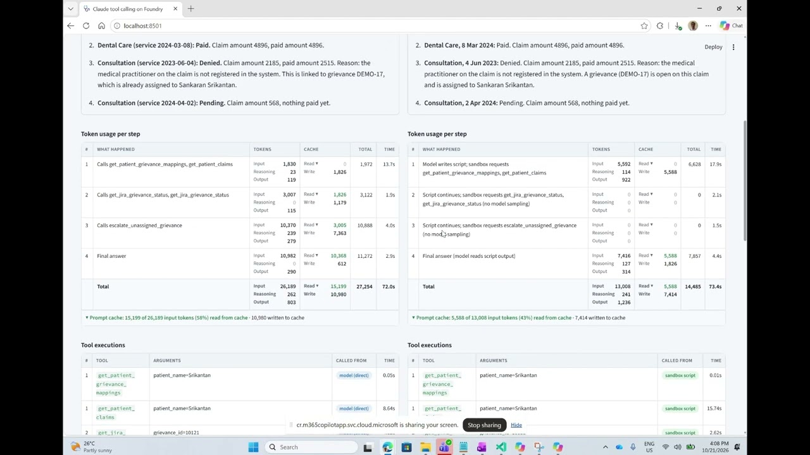
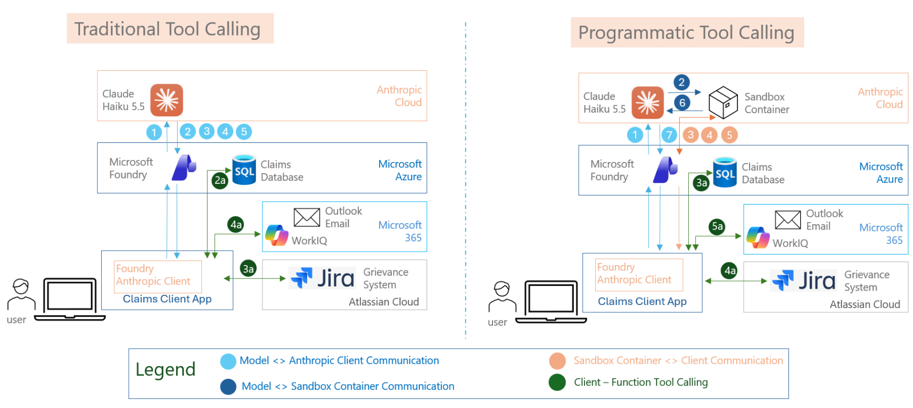

# Cut token costs in agentic AI with Claude on Microsoft Foundry

An AI agent that calls many tools can burn several times more tokens than it needs to, because every round trip re-reads the whole conversation. This project runs the **same insurance-claims question** through an agent two ways, side by side, and shows exactly where the tokens go:

1. **Traditional tool calling**: the model sits in the middle of every step.
2. **Programmatic tool calling**: Claude writes one short script that runs in a sandbox and calls the tools itself, and the model returns only to compose the final answer.

**Prompt caching** is on for both runs, so you can also see how much repeated input is served from cache.

## Watch the demo

## Read the article

[The Token Economics of Agentic AI: Programmatic Tool Calling and Prompt Caching in Practice](https://www.linkedin.com/pulse/token-economics-agentic-ai-programmatic-tool-calling-prompt-sankaran-pldqc/) (LinkedIn)

## How it works

The agent answers a patient's question about the status of their claims using four tools: a local grievance mapping, claims in **Azure SQL** (Microsoft Entra ID authentication), grievance status from **Jira Cloud**, and escalation e-mail through **WorkIQ** in Microsoft 365. All tools run in the client app; neither the model nor the sandbox touches the backends directly.

## Get the code

The full source, setup steps and a detailed walkthrough of both approaches are in the
[GitHub repository](https://github.com/MSFT-Innovation-Hub-India/Claude-Foundry-Programmtic-Tool-Calling).

**Topics:** Claude, Microsoft Foundry, Azure AI Foundry, programmatic tool calling, prompt caching, agentic AI, token optimization, Streamlit.
